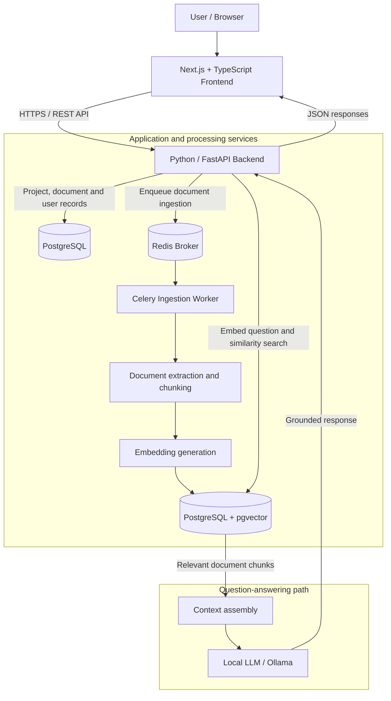
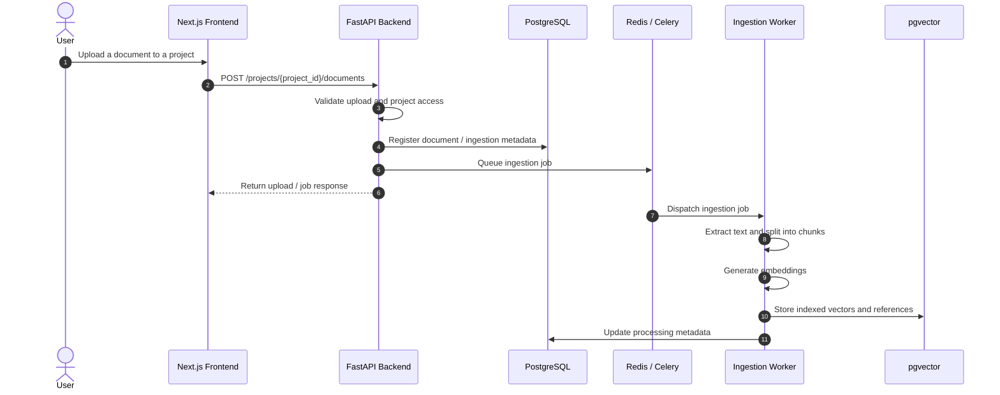
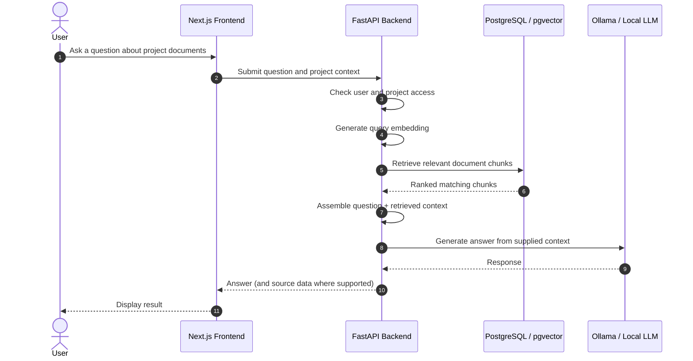
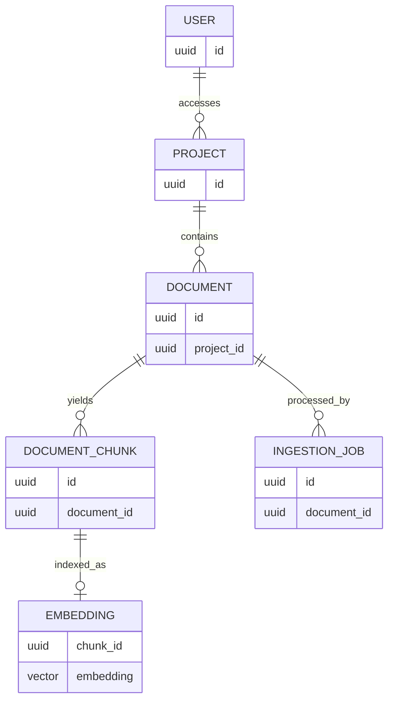

**RagLab**

A full-stack, document-grounded AI workspace built with Retrieval-Augmented Generation (RAG)

Upload documents · Organize knowledge by project · Search semantically · Ask questions with relevant context

    
Frontend Repository · Backend Repository

Overview
RagLab is a full-stack Retrieval-Augmented Generation (RAG) application designed to turn user-provided documents into searchable, AI-ready knowledge. It separates a responsive web interface from a Python API and an asynchronous document-processing pipeline, allowing document ingestion and interactive queries to evolve independently.

The application brings together document management, text extraction and chunking, vector embeddings, semantic retrieval, and locally run language-model workflows. Instead of relying only on information learned during model training, RAG uses retrieved document context to support answers to user questions.

This repository is the project overview and architecture hub. The implementation is maintained in two dedicated repositories:
Repository	Responsibility	Link
RagLab Frontend	Web experience, project and document management, search and chat interfaces	View frontend →
RagLab Backend	REST APIs, authorization, document ingestion, background processing, retrieval and persistence	View backend →

Repository links: Replace YOUR_USERNAME, YOUR_FRONTEND_REPO, and YOUR_BACKEND_REPO with your actual public GitHub repository paths before publishing.

Key Capabilities
- Project-oriented document organization: create projects and associate uploaded documents with them.
- Document ingestion: accept documents, process extracted content, and prepare it for retrieval.
- Background processing: offload ingestion work to Celery workers using Redis rather than blocking the API request.
- Semantic search: find relevant passages through embeddings and PostgreSQL with pgvector.
- Retrieval-augmented responses: retrieve relevant source context for use in a language-model prompt.
- Local AI workflows: support local inference with Ollama, reducing dependence on third-party model APIs.
- Document access controls: validate user access to projects and their documents in the backend.
- Separated application layers: keep the frontend, API, workers, database, and model runtime independently maintainable.
Implementation scope: The architecture below combines known project design details with a conceptual RAG flow. Exact UI features, model names, request/response shapes, deployment topology, and current operational status should be verified against the two code repositories.

System Architecture

Component Responsibilities
Component	Technology	Responsibility
Client application	Next.js, React, TypeScript	Render project/document interfaces and communicate with the API
API service	Python, FastAPI	Validate requests, enforce access rules, orchestrate storage, retrieval and responses
Persistence	PostgreSQL	Store application records, including projects and documents
Vector search	pgvector	Persist embeddings and perform vector similarity retrieval
Task queue	Redis	Broker ingestion jobs between the API and workers
Background processing	Celery	Process document ingestion outside interactive API requests
Document processing	Unstructured / Python processing pipeline	Extract and prepare text for chunking and indexing
RAG orchestration	LangChain / Python services	Connect retrieval, context construction and model inference
Local model runtime	Ollama	Run language-model inference locally
Containerization	Docker	Support repeatable, isolated development or runtime environments

Design principle: the API coordinates requests; long-running ingestion is performed by workers; persistent data and vectors live in PostgreSQL. This separation makes document processing easier to scale without coupling it to the frontend.
End-to-End Data Flows
1. Document Ingestion

Why asynchronous ingestion? Parsing, chunking, and embedding can take much longer than a normal API request. Queueing this work helps keep interactive requests responsive and provides a path for worker-based scaling.
2. Question Answering / Retrieval

Why RAG? The retrieval step gives the model application-specific document content at query time, helping it answer questions about material that may not have appeared in pretraining. Retrieval quality and response grounding still depend on the quality of the uploaded content, embedding pipeline, and prompting strategy.
Technology Stack
Layer	Technologies
Frontend	Next.js, React, TypeScript
Backend	Python, FastAPI
Database	PostgreSQL
Vector retrieval	pgvector
Background jobs	Celery, Redis
Parsing and RAG	Unstructured, LangChain, Python
Local inference	Ollama
Packaging	Docker

Architectural Decisions
Dedicated frontend and backend repositories
The frontend and backend are separate repositories, with this repository serving as their common entry point. This keeps UI and API development histories independent while giving reviewers one place to understand the overall system.
Asynchronous document ingestion
The API can enqueue a background task after accepting a document. Celery workers handle the expensive processing stages, allowing ingestion work to be isolated from user-facing request handling.
PostgreSQL plus pgvector
Relational application data and vector embeddings can be managed within the PostgreSQL ecosystem. The vector extension supports semantic similarity queries alongside the project's relational data model.
Local model execution
Ollama enables a local inference path that can reduce reliance on hosted LLM providers. Actual offline behavior depends on the configured embedding models, runtime, and whether models have already been downloaded.
Project-scoped data access
Project membership and ownership checks belong in the backend, not solely in frontend visibility rules. Retrieval must honor the same authorization boundaries as document listing and downloads, to avoid exposing data across projects.
API Surface
The backend has included project and document endpoints such as the following. Refer to the backend repository for the authoritative OpenAPI schema, request bodies, authentication requirements, and complete route list.
Operation	Endpoint	Purpose
Create project	POST /projects	Create a project/workspace
Upload document	POST /projects/{project_id}/documents	Upload a document into a project
List / retrieve documents	See backend OpenAPI documentation	Access project documents with authorization checks
Ask / retrieve	See backend OpenAPI documentation	Execute retrieval and any available question-answering workflow

Note: The table intentionally omits unverified endpoint URLs for chat, search, and ingestion-job status.
Data Model (Conceptual)

Illustrative relationships only—not a reproduction of the actual SQL schema. Some implementations store embeddings directly on chunk rows or model access using explicit membership tables.
Repository Navigation
RagLab/                         # This overview repository
└── README.md                   # Architecture and links

RagLab Frontend/                # Separate GitHub repository
└── ...                         # Next.js source and UI components

RagLab Backend/                 # Separate GitHub repository
└── ...                         # FastAPI source, workers, migrations, tests
- Frontend: Source, setup, components and UI →
- Backend: Source, API setup, database and background workers →
Running the Project
RagLab's two codebases are maintained separately. Follow their own READMEs for tested install commands, environment variables and current startup instructions. A typical local development environment requires:
1. PostgreSQL with the pgvector extension available.
2. Redis for Celery task dispatch.
3. The Python/FastAPI application and Celery worker.
4. Any configured local embedding models and Ollama language model.
5. The Next.js frontend configured to point at the backend API.
Do not commit credentials, database passwords, tokens, uploaded private documents, or .env files. Model choices, ports, container names and required environment variables should be read from the implementation repositories instead of assumed from this overview.

Engineering and Quality Considerations
The backend design includes database migrations, API tests and CI workflows. For the latest test commands and pipeline status, consult the backend repository.

Core quality priorities for a system like RagLab include:
- Authorization: verify project access on every upload, download and retrieval path.
- Ingestion reliability: track failures and prevent incomplete documents from being treated as indexed.
- Retrieval relevance: evaluate whether returned chunks answer the actual question.
- Data lifecycle: coordinate deletions of documents, chunks and embeddings.
- Observability: distinguish HTTP request failures from asynchronous worker failures.
- Reproducibility: document environment configuration and model dependencies in each implementation repository.
Project Highlights
RagLab demonstrates full-stack integration across a TypeScript web application, an asynchronous Python API, relational and vector storage, background job processing, and retrieval-based AI inference. It showcases architectural boundaries between interactive APIs and expensive data-processing workflows, with an emphasis on project-level document organization and retrieval.
Further Documentation
For implementation-level details, use the dedicated repositories:

Frontend implementation · Backend implementation

  RagLab · Full-stack document intelligence with retrieval-augmented generation

